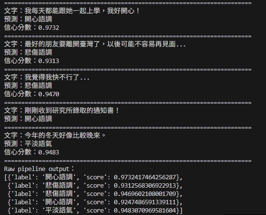
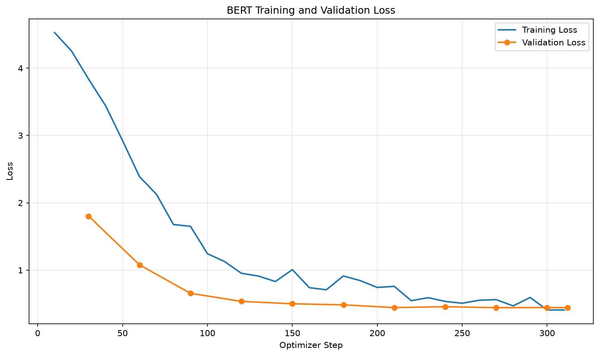
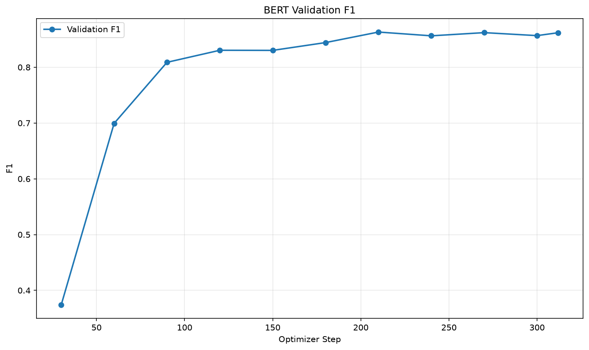

# 中文句子情緒分類

## 訓練資料來源

- [Datasets:Johnson8187/Chinese_Multi-Emotion_Dialogue_Dataset](https://huggingface.co/datasets/Johnson8187/Chinese_Multi-Emotion_Dialogue_Dataset)

## 基礎模型

- [google-bert/bert-base-chinese](https://huggingface.co/google-bert/bert-base-chinese)

## 安裝套件

- accelerate              1.15.0
  aiohappyeyeballs        2.7.1
  aiohttp                 3.14.5
  aiosignal               1.4.0
  annotated-doc           0.0.5
  anyio                   4.15.1
  asttokens               3.0.2
  attrs                   26.1.0
  click                   8.5.0
  cloudpickle             3.1.2
  colorama                0.4.6
  comm                    0.2.3
  contourpy               1.4.0
  cycler                  0.12.1
  datasets                5.1.0
  debugpy                 1.8.22
  dill                    0.4.1
  executing               2.3.0
  filelock                4.2.4
  fonttools               4.68.0
  frozenlist              1.8.0
  fsspec                  2026.7.0
  h11                     0.16.0
  hf-xet                  1.7.1
  httpcore2               2.16.0
  httpx2                  2.16.0
  huggingface_hub         2.3.0
  idna                    3.20
  ipykernel               7.4.0
  ipython                 9.17.1
  ipython_pygments_lexers 1.1.1
  jedi                    0.20.1
  Jinja2                  3.1.6
  joblib                  1.6.0
  jupyter_client          8.10.0
  jupyter_core            5.9.1
  kiwisolver              1.5.1
  markdown-it-py          4.2.0
  MarkupSafe              3.0.4
  matplotlib              3.11.2
  matplotlib-inline       0.2.2
  mdurl                   0.1.2
  mpmath                  1.3.0
  multidict               7.2.1
  multiprocess            0.70.19
  narwhals                2.28.0
  nest-asyncio2           1.7.4
  networkx                3.7
  numpy                   2.5.4
  packaging               26.3
  pandas                  3.1.0
  parso                   0.8.7
  pillow                  13.0.0
  pip                     25.0.1
  platformdirs            4.14.0
  prompt_toolkit          3.0.53
  propcache               0.5.4
  psutil                  7.2.2
  pure_eval               0.2.4
  pyarrow                 26.0.0
  Pygments                2.21.0
  pyparsing               3.3.3
  python-dateutil         3.0.0
  PyYAML                  6.0.3
  pyzmq                   27.2.0
  regex                   2026.9.29
  rich                    15.0.0
  safetensors             0.8.0
  scikit-learn            1.9.1
  scipy                   1.18.1
  setuptools              84.2.1
  shellingham             1.5.4
  six                     1.17.0
  stack-data              0.6.3
  sympy                   1.13.1
  threadpoolctl           3.7.0
  tokenizers              0.23.3
  torch                   2.6.0+cu118
  tornado                 6.6
  tqdm                    4.70.1
  traitlets               5.16.1
  transformers            5.21.0
  truststore              0.10.5
  typer                   0.27.3
  typing_extensions       4.16.0
  tzdata                  2026.6
  wcwidth                 0.9.4
  xxhash                  4.0.2
  yarl                    1.25.1

## 說明

1. 專案介紹

本專案使用 BERT（Bidirectional Encoder Representations from Transformers） 預訓練語言模型，透過 Fine-tuning（微調）技術，建立中文句子的多類別情緒分類模型。

原始範例為二元情感分類，僅能判斷正面（Positive）與負面（Negative）。本次作業改用 Chinese Multi-Emotion Dialogue Dataset，將不同情緒分為八個類別，讓模型能夠辨識不同的情緒語調，而不只是單純區分正面或負面情緒。

2. 資料集與模型

訓練資料集： Johnson8187/Chinese_Multi-Emotion_Dialogue_Dataset

基礎模型： google-bert/bert-base-chinese

訓練方式： Supervised Fine-tuning（監督式微調）

任務類型： Multi-class Text Classification（多類別文字分類）

資料集包含中文句子與對應的情緒標籤。由於原始標籤為文字格式，因此在資料前處理階段，先將不同情緒轉換為整數編號，分別為 0~7 ，供模型進行訓練。

情緒類別數量依實際讀取的資料集標籤決定。

## 執行方法

`python prepare_data.py`
`python train_bert.py`
`python infer_bert.py`
`python plot_bert_metrics.py`

## 成果

## 其它你想要補充標題和內容

資展電腦好爛阿 裝個gpu能用的CUDA都要裝半天 

1050 只能支援到CUDA13.0哭阿

最後裝個11.8好不容易才能用
